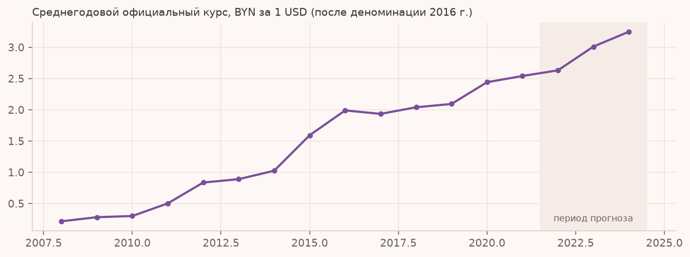
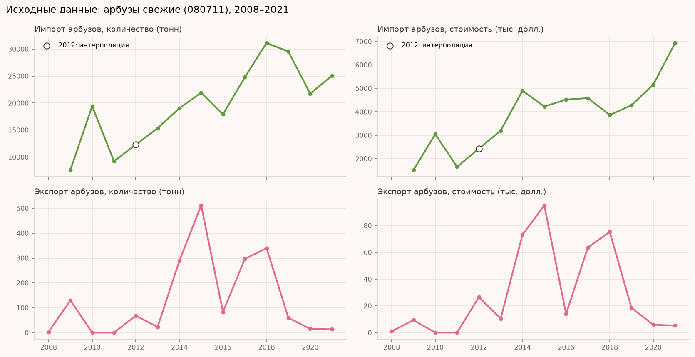
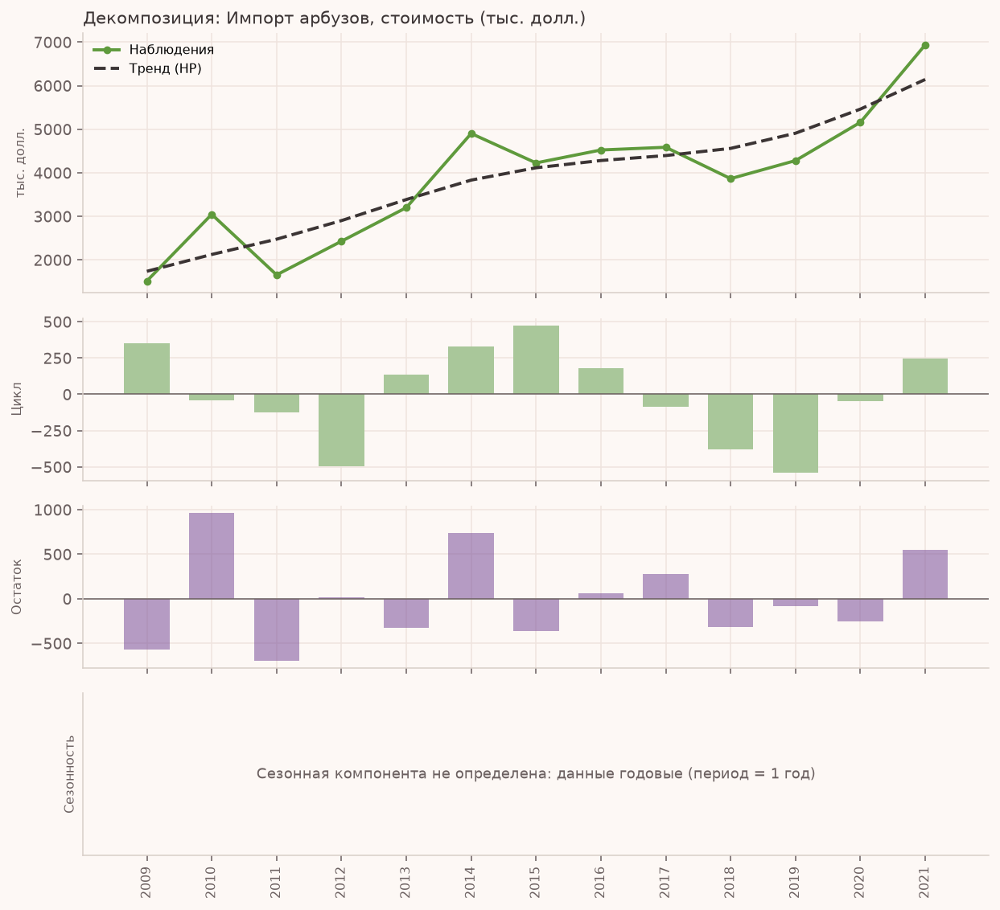
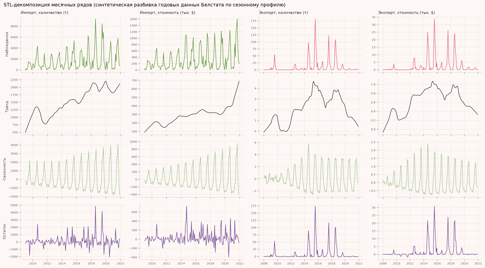
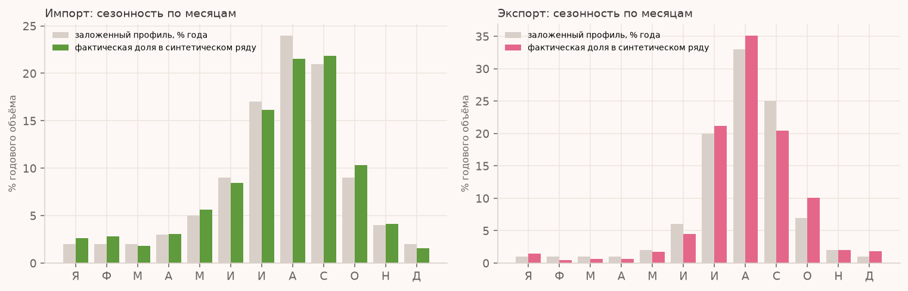
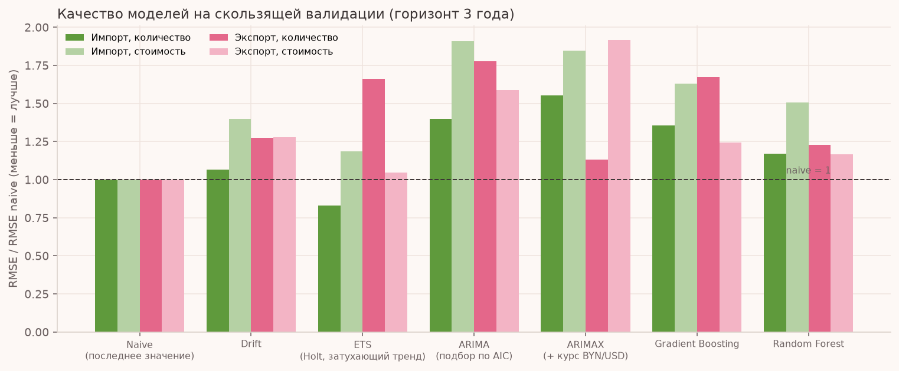
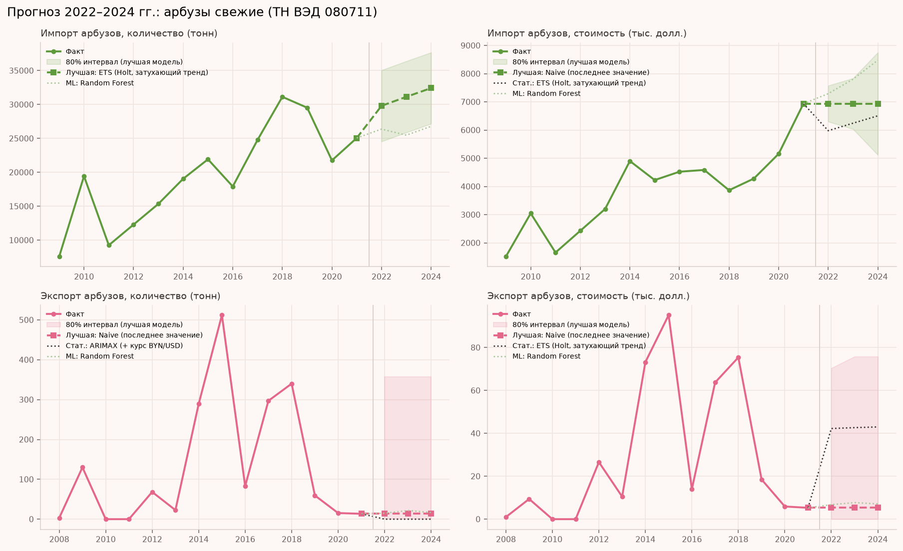
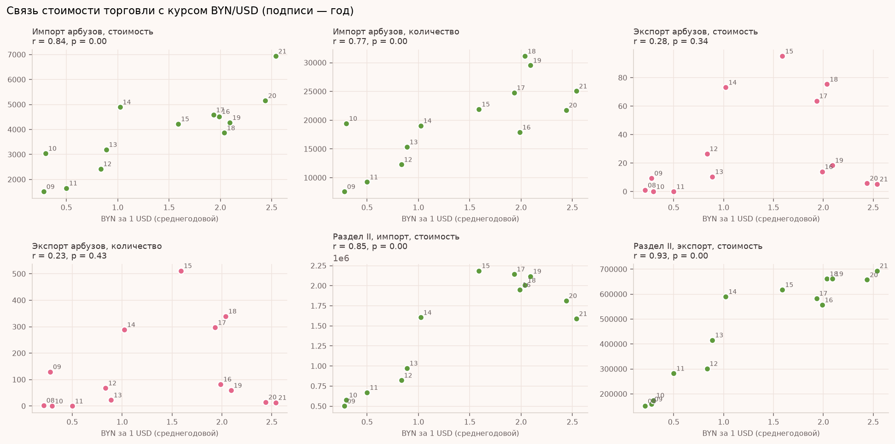

# Задание 2. Арбузы свежие (ТН ВЭД 080711): декомпозиция, прогноз 2022–2024 и связь с курсом BYN/USD

Анализ внешней торговли Республики Беларусь арбузами свежими (код 080711) по данным Белстата за 2008–2021 гг., прогноз на 2022–2024 гг. по четырём показателям и исследование связи с официальным курсом белорусского рубля к доллару США.

## 1. Данные

### 1.1. Внешняя торговля (Белстат)

Источник: «Экспорт и импорт товаров (6 знаков ТН ВЭД ЕАЭС)», раздел II «Продукты растительного происхождения», годовые файлы 2009–2021. Каждый файл содержит два года (предыдущий и отчётный), поэтому ряды собраны из соседних файлов. Для каждого года извлечены:

- по товару 080711: количество (тонны) и стоимость (тыс. долл. США), отдельно экспорт и импорт;
- итоги раздела II (стоимость, тыс. долл. США), экспорт и импорт: используются как дополнительные ряды для декомпозиции и корреляции.

Исходные файлы лежат в [`data/raw/`](data/raw/README.md). Значения по арбузам перенесены из них вручную в таблицу с указанием файла-источника по каждому году: [`data/manual/manual_input_watermelon_080711.csv`](data/manual/manual_input_watermelon_080711.csv). Единый документ с первоначальными данными: [`data/processed/unified_source_data.xlsx`](data/processed/unified_source_data.xlsx). Итоговая таблица для расчётов: [`data/processed/dataset_2008_2024.csv`](data/processed/dataset_2008_2024.csv).

**Особенности данных (важно для интерпретации):**

| Особенность | Как обработано |
|---|---|
| Данные только годовые, 14 точек на ряд | Сезонность в годовых данных не выделяется; для неё построен отдельный блок на синтетической помесячной разбивке (раздел 2.2). |
| На сайте Белстата в разделе «Импорт товаров» за 2008–2009 и 2012–2013 гг. размещены файлы экспорта | Данных импорта за эти годы в опубликованных файлах нет, поэтому ряды импорта начинаются с 2009 г. (13 точек). Значение 2012 г. заполнено линейной интерполяцией между 2011 и 2013 гг. |
| В 2010 и 2011 гг. экспорта арбузов не было | Принято значение 0. |
| В файлах 2012–2013 гг. и 2019–2021 гг. количество указано в килограммах | Приведено к тоннам. |
| Экспорт крайне мал и нерегулярен (от 0 до 512 тонн в год) | Это ограничивает качество прогноза экспорта (раздел 4). |

### 1.2. Курс BYN/USD (Нацбанк Республики Беларусь)

Источник: официальный ежедневный курс доллара США, установленный Национальным банком РБ. Рассчитан среднегодовой курс. Курсы до 1 июля 2016 г. указаны в старых белорусских рублях и приведены к современным делением на 10 000 (деноминация). Исходные файлы: [`data/raw/nbrb_fx/`](data/raw/nbrb_fx). Код: [`src/fx_parse.py`](src/fx_parse.py), результат: [`data/processed/fx_usd_daily.csv`](data/processed/fx_usd_daily.csv).



Среднегодовой курс вырос с 0,21 BYN за 1 USD в 2008 г. до 3,25 в 2024 г., с резкими девальвациями в 2009, 2011 и 2015 гг.



## 2. Декомпозиция рядов

### 2.1. Годовые данные: тренд, цикл, остаток

**Метод.** Данные годовые, поэтому сезонная компонента (внутригодовая) не определена: период сезонности равен одному году. Вместо неё ряды раскладываются на:

- **тренд**: фильтр Ходрика–Прескотта с параметром сглаживания λ = 6,25 ( рекомендуемое значение для годовых данных);
- **цикл**: отклонения от тренда, сглаженные центрированным скользящим средним по 3 годам;
- **остаток**: оставшаяся нерегулярная компонента.

Разложение выполнено для четырёх рядов по арбузам и для двух рядов итогов раздела II (экспорт и импорт). Таблица всех компонент: [`results/decomposition.csv`](results/decomposition.csv).



Остальные графики: [`decomp_import_qty.png`](figures/decomp_import_qty.png), [`decomp_export_qty.png`](figures/decomp_export_qty.png), [`decomp_export_value.png`](figures/decomp_export_value.png), [`decomp_sec2_export.png`](figures/decomp_sec2_export.png), [`decomp_sec2_import.png`](figures/decomp_sec2_import.png).

**Интерпретация:**

- **Импорт арбузов**: выраженный восходящий тренд. Тренд физического объёма вырос с примерно 10 до 25,5 тыс. т (2009–2021 гг.), стоимости с 1,7 до 6,1 млн долл. Циклические отклонения невелики (порядка ±500 тыс. долл. по стоимости) и отражают годы повышенных (2014–2015 гг.) и пониженных (2012 г., 2018–2019 гг.) закупок. Остаток (до ±1 млн долл.) соответствует разовым колебаниям (например, 2010 г. и 2011 г.).
- **Экспорт арбузов**: устойчивого тренда нет. Ряд состоит из эпизодических всплесков (2009, 2012, 2014–2015, 2017–2018 гг.) и обнулений, а тренд HP сглаживает их в горку с пиком около 2015–2016 гг. (порядка 265 т) и спадом к 2021 г. (до уровня около 2 т). Цикл и остаток по амплитуде сопоставимы с самим рядом, то есть экспорт определяется скорее случайными событиями, чем закономерностью.
- **Раздел II в целом**: уверенный рост (экспорт по тренду с 117 до 692 млн долл., импорт с 391 до 1 729 млн долл.) с замедлением после 2014–2015 гг. Это фон, на котором арбузы составляют малую долю.

### 2.2. Сезонность: синтетическая помесячная разбивка

Сезонную компоненту по годовым данным определить нельзя. Чтобы показать выделение сезонности, годовые значения Белстата **разбиты на месяцы**:

- для импорта и экспорта задан сезонный профиль (арбуз — летний товар; пик июль–сентябрь, на август приходится около 24% годового импорта и 33% экспорта);
- каждый год профиль случайно варьируется (распределение Дирихле, фиксированный seed), чтобы сезон не был одинаков из года в год;
- сумма по месяцам каждого года **точно равна** годовому значению Белстата.

Для месячных рядов выполнена STL-декомпозиция (тренд, сезонность, остаток) и месячный сезонный SARIMA(0,1,1)(0,1,1)₁₂, агрегированный до годового прогноза.




**Важная оговорка.** Выделенная здесь сезонность заложена допущением, а не оценена по реальным помесячным данным. Её нельзя трактовать как свойство рынка; блок демонстрирует методику и позволяет сравнить годовой и сезонный подходы. При наличии фактических помесячных данных месячный ряд заменяется без изменения кода (`data/monthly_SYNTHETIC.csv` - реальные данные).

**Сравнение с годовым прогнозом** (`results/forecast_monthly_sarima_SYNTHETIC.csv`, `figures/forecast_monthly_sarima_SYNTHETIC.png`):

| Показатель, 2022 / 2024 | Месячный SARIMA (сумма за год) | Лучшая годовая модель (раздел 4) |
|---|---|---|
| Импорт, количество (т) | 25 627 / 26 430 | 29 802 / 32 421 |
| Импорт, стоимость (тыс. $) | 7 829 / 9 561 | 5 977 / 6 505 |
| Экспорт, количество (т) | 105 / 103 | 13,5 / 13,5 |
| Экспорт, стоимость (тыс. $) | 22 / 21 | 5,3 / 5,3 |

Для импорта обе модели дают рост, но разные уровни (месячная модель с сезонным дифференцированием продолжает резкий прирост стоимости 2021 г.; годовая ETS его сглаживает). Расхождения укладываются в интервалы друг друга. Для экспорта месячный интервал очень широк (до сотен тонн), что подтверждает вывод о непредсказуемости ряда. Месячный блок носит вспомогательный характер: его качество отдельно не оценивалось, а основной выбор модели сделан на годовых данных (раздел 4).

## 3. Методология прогноза

**Цель:** прогноз на 2022, 2023, 2024 гг. четырёх показателей: импорт (количество, стоимость) и экспорт (количество, стоимость).

### 3.1. Модели

| Группа | Модель | Описание |
|---|---|---|
| Базовые | Naive | прогноз равен последнему значению |
| | Drift | линейная экстраполяция тренда между первой и последней точками |
| Статистические | ETS (Holt) | экспоненциальное сглаживание с аддитивным затухающим трендом |
| | ARIMA | подбор порядка (p, d, q) и компонента тренда по критерию AIC из небольшого набора; сезонная часть не используется, так как данные годовые (SARIMA с периодом 1 вырождается в ARIMA) |
| | ARIMAX | ARIMA с внешним регрессором: логарифм среднегодового курса BYN/USD (курс на 2022–2024 гг. известен) |
| Машинное обучение | Gradient Boosting | градиентный бустинг над деревьями (scikit-learn) |
| | Random Forest | случайный лес (scikit-learn) |

Модели машинного обучения предсказывают **годовой прирост** показателя по признакам: значение за прошлый год, прирост за прошлый год, логарифм курса текущего года и его прирост. Прогноз на несколько лет вперёд строится рекурсивно. Бустинг и лес реализованы средствами scikit-learn (аналоги XGBoost/LightGBM); LSTM не применялся: для 12–14 наблюдений нейросеть неприменима.

### 3.2. Валидация

Скользящая (expanding window) проверка с горизонтом 3 года: обучение до года T, прогноз на T+1…T+3; T = 2014, 2015, 2016, 2017, 2018. Итого 15 прогнозных точек на каждую пару «модель × показатель». Метрики: MAE, RMSE, sMAPE и отношение RMSE к RMSE наивной модели (меньше 1 означает, что модель лучше наивной). Лучшая модель выбирается по минимальному RMSE.

Метрики по всем моделям: [`results/cv_metrics.csv`](results/cv_metrics.csv); отдельные прогнозы валидации: [`results/cv_forecasts.csv`](results/cv_forecasts.csv).



### 3.3. Интервалы

Для ARIMA/ARIMAX/ETS используются модельные 80% доверительные интервалы. Для остальных моделей (Naive, Drift, бустинг, лес) интервал строится по эмпирической ошибке валидации для соответствующего горизонта. Нижняя граница ограничена нулём.

## 4. Результаты прогноза

### 4.1. Качество моделей (RMSE, скользящая валидация)

| Модель | Импорт, кол-во (т) | Импорт, стоимость (тыс. $) | Экспорт, кол-во (т) | Экспорт, стоимость (тыс. $) |
|---|---:|---:|---:|---:|
| Naive | 6 866 | 958 | **244** | **49,5** |
| Drift | 7 308 | 1 340 | 310 | 63,4 |
| ETS (Holt) | **5 686** | **939** | 405 | 51,8 |
| ARIMA | 9 605 | 1 828 | 434 | 83,3 |
| ARIMAX (+ курс) | 10 683 | 1 777 | 276 | 94,9 |
| Gradient Boosting | 9 295 | 1 559 | 408 | 61,6 |
| Random Forest | 8 039 | 1 443 | 300 | 57,8 |

Лучшая модель по каждому показателю выделена жирным. Полные таблицы (MAE, sMAPE, отношение к naive): `results/cv_metrics.csv`.

### 4.2. Выбор лучшей модели и обоснование

| Показатель | Лучшая модель | RMSE к naive | Лучшая статистическая | Лучшая ML-модель |
|---|---|---:|---|---|
| Импорт, количество | **ETS (Holt)** | 0,83 | ETS | Random Forest (1,17) |
| Импорт, стоимость | **ETS (Holt)** | 0,98 | ETS | Random Forest (1,51) |
| Экспорт, количество | **Naive** | 1,00 | ARIMAX (1,13) | Random Forest (1,23) |
| Экспорт, стоимость | **Naive** | 1,00 | ETS (1,05) | Random Forest (1,17) |

- **Импорт, количество**: ETS на 17% точнее наивного прогноза (RMSE 5 686 против 6 866 т, MAE ниже на 15%). Это единственный показатель, где сложная модель убедительно лучше базовой.
- **Импорт, стоимость**: ETS лишь на 2% точнее наивной модели по RMSE (939 против 958 тыс. $), но уступает ей по MAE (781 против 648). Различие между ETS и naive статистически несущественно, поэтому выбор ETS обусловлен только формальным критерием RMSE и тем, что ETS даёт модельный доверительный интервал.
- **Экспорт**: ни одна модель не превзошла наивную (последнее значение). Ряды нерегулярны, обучение на нескольких наблюдениях со всплесками не даёт выигрыша. sMAPE для экспорта около 100% у всех моделей, то есть точечный прогноз по сути непредсказуем.
- **ML-модели** (бустинг, лес) на этих рядах не превзошли статистические. Причины: очень мало данных (12–14 точек, в обучении ещё меньше), деревья не экстраполируют уровень, а ряды содержат единичные выбросы. **ARIMA** с автоподбором по AIC переобучается на коротком ряду и показывает худший результат на валидации. **Курс как внешний регрессор (ARIMAX)** качество импорта не улучшил (хуже базовой ARIMA или сопоставимо), по экспорту количества дал небольшое улучшение относительно ARIMA, но не относительно naive.

### 4.3. Прогноз лучшей моделью

| Показатель | Модель | 2022 | 2023 | 2024 |
|---|---|---:|---:|---:|
| Импорт, количество (т) | ETS | 29 802 (24 547 – 35 056) | 31 128 (25 874 – 36 383) | 32 421 (27 166 – 37 675) |
| Импорт, стоимость (тыс. $) | ETS | 5 977 (5 028 – 6 927) | 6 244 (5 295 – 7 193) | 6 505 (5 556 – 7 454) |
| Экспорт, количество (т) | Naive | 13,5 (0 – 357) | 13,5 (0 – 357) | 13,5 (0 – 357) |
| Экспорт, стоимость (тыс. $) | Naive | 5,3 (0 – 70) | 5,3 (0 – 76) | 5,3 (0 – 76) |

В скобках: 80% интервал. Прогнозы всех моделей: [`results/forecasts_all_models.csv`](results/forecasts_all_models.csv); лучшей модели: [`results/forecasts_best_model.csv`](results/forecasts_best_model.csv).



**Интерпретация:**

- **Импорт** продолжает умеренный рост: объём 30–32 тыс. т в год, стоимость 6,0–6,5 млн долл. Прогноз стоимости на 2022 г. ниже факта 2021 г. (6,9 млн долл.), потому что модель сглаживает резкий скачок 2021 г. Интервалы относительно узкие, но они получены из небольшой выборки и недооценивают реальную неопределённость.
- **Экспорт** прогнозируется на уровне последнего наблюдения (около 13,5 т и 5 тыс. $). Это скорее признание непредсказуемости ряда, чем содержательный прогноз; интервал от 0 до 357 т показывает, что допустимы и нулевой экспорт, и всплеск порядка сотен тонн.

## 5. Корреляция с курсом BYN/USD

Для рядов 2008–2021 гг. рассчитаны корреляции Пирсона и Спирмена между среднегодовым курсом BYN/USD и стоимостью (и количеством) торговли в трёх вариантах: по уровням, по годовым приростам, по уровням с лагом курса в один год. Полная таблица с p-значениями: [`results/correlations.csv`](results/correlations.csv).



| Ряд | Уровни (Пирсон r, p) | Приросты (Пирсон r, p) |
|---|---|---|
| Импорт арбузов, стоимость | 0,84 (p < 0,001) | −0,29 (p = 0,37) |
| Импорт арбузов, количество | 0,77 (p = 0,002) | −0,44 (p = 0,16) |
| Экспорт арбузов, стоимость | 0,28 (p = 0,34) | −0,15 (p = 0,62) |
| Экспорт арбузов, количество | 0,23 (p = 0,43) | −0,05 (p = 0,87) |
| Раздел II, импорт, стоимость | 0,85 (p < 0,001) | 0,08 (p = 0,80) |
| Раздел II, экспорт, стоимость | 0,93 (p < 0,001) | −0,28 (p = 0,35) |

**Интерпретация:**

- По **уровням** связь импорта арбузов и итогов раздела II с курсом сильная и значимая (r около 0,8–0,9). Но и курс, и объёмы торговли растут во времени (курс BYN/USD вырос в 15 раз за период), поэтому такая корреляция в основном отражает общий тренд, а не причинную связь. Это подтверждается второй колонкой: на **приростах** (после удаления тренда) связь исчезает (r от −0,44 до 0,08, все p > 0,15).
- Единственное исключение: ранговая корреляция Спирмена по приростам количества импорта арбузов (ρ = −0,64, p = 0,03). Она одна из 18 проверенных и при такой выборке может быть случайной; корреляция Пирсона для того же ряда незначима (p = 0,16), поэтому устойчивой связью это считать нельзя.
- Для **экспорта арбузов** связь отсутствует и по уровням, и по приростам (|r| < 0,3, p > 0,3).
- Лаг курса на год даёт те же выводы, что и без лага.
- Практический вывод: между изменениями курса и изменениями стоимости торговли арбузами устойчивой статистической связи в данных не обнаружено. Стоимость измеряется в долларах, поэтому курс влияет на неё косвенно (через цены и спрос в белорусских рублях), и это косвенное влияние на 12–13 годовых наблюдениях не выявляется. Добавление курса в модель (ARIMAX) качество прогноза не улучшило.

## 6. Итоговые выводы

1. **Данные.** Годовые ряды 2008–2021 гг. (14 точек, у импорта 13) дают очень ограниченную основу для статистического моделирования. Сезонность в таких данных выделить нельзя; она показана на синтетической помесячной разбивке (допущение, не оценка).
2. **Декомпозиция.** Импорт арбузов имеет устойчивый рост (тренд), экспорт состоит из эпизодических всплесков без тренда. Итоги раздела II растут с замедлением после 2014–2015 гг.
3. **Прогноз.** Импорт: рост до примерно 32 тыс. т и 6,5 млн долл. к 2024 г. (лучшая модель ETS). Экспорт: на уровне последнего значения (около 13 т, 5 тыс. долл.) с очень широким интервалом.
4. **Модели.** Статистические модели (ETS) лучше моделей машинного обучения на этих данных; для экспорта ни одна модель не превзошла наивную. Это ожидаемо при 12–14 наблюдениях и нерегулярных рядах: сложные модели без достаточного объёма данных не дают выигрыша.
5. **Курс.** Корреляция с курсом по уровням обусловлена общим трендом; по приростам связь не выявлена.

## 7. Ограничения

- Короткие ряды: надёжность прогнозов и интервалов ограничена. Интервалы для naive/ML-моделей получены из 5 скользящих окон и приблизительны.
- Значение импорта за 2012 г. заполнено интерполяцией, импорт за 2008 г. отсутствует (ряд импорта начинается с 2009 г.).
- Экспорт арбузов нерегулярен и мал; прогноз по нему носит иллюстративный характер.
- Сезонная декомпозиция выполнена на синтетических помесячных данных: сезонность в ней задана профилем.
- Корреляции рассчитаны по 12–14 наблюдениям; p-значения следует интерпретировать осторожно.
- Не учтены внешние факторы (урожайность, цены на мировом рынке, ограничения на торговлю), которых нет в исходных данных.

## 8. Структура репозитория и запуск

```
task2/
├── README.md
├── requirements.txt
├── data/
│   ├── raw/                       # исходные файлы, скачанные с сайтов Белстата и Нацбанка
│   │   ├── belstat_export/        # экспорт, раздел II, 2009–2021
│   │   ├── belstat_import/        # импорт, раздел II, 2010–2021 (кроме периодов с ошибочными файлами)
│   │   └── nbrb_fx/               # официальный курс по дням, 2008–2024
│   ├── manual/
│   │   └── manual_input_watermelon_080711.csv   # значения 080711, перенесённые вручную из raw
│   └── processed/                 
│       ├── fx_usd_daily.csv
│       ├── dataset_2008_2024.csv  (и _raw без интерполяции)
│       ├── unified_source_data.xlsx   # единый документ с данными
│       └── monthly_SYNTHETIC.csv      # синтетическая помесячная разбивка
├── src/
│   ├── fx_parse.py        # 1) файлы Нацбанка -среднегодовой курс BYN/USD
│   ├── build_dataset.py   # 2) собирает всё в одну таблицу
│   ├── analysis.py        # 3) декомпозиция, прогноз, корреляция, графики
│   └── monthly.py         # 4) синтетическая помесячная разбивка, STL, месячный SARIMA
├── figures/               # графики
└── results/               # таблицы метрик, прогнозов, корреляций, декомпозиции
```

Запуск (по порядку):

```bash
pip install -r requirements.txt
python src/fx_parse.py "data/raw/nbrb_fx/*_day_ru.xls" data/processed/fx_usd_daily.csv
python src/build_dataset.py
python src/analysis.py
python src/monthly.py
```

Источники: Национальный статистический комитет Республики Беларусь (внешняя торговля товарами, 6 знаков ТН ВЭД ЕАЭС); Национальный банк Республики Беларусь (официальный курс белорусского рубля).
